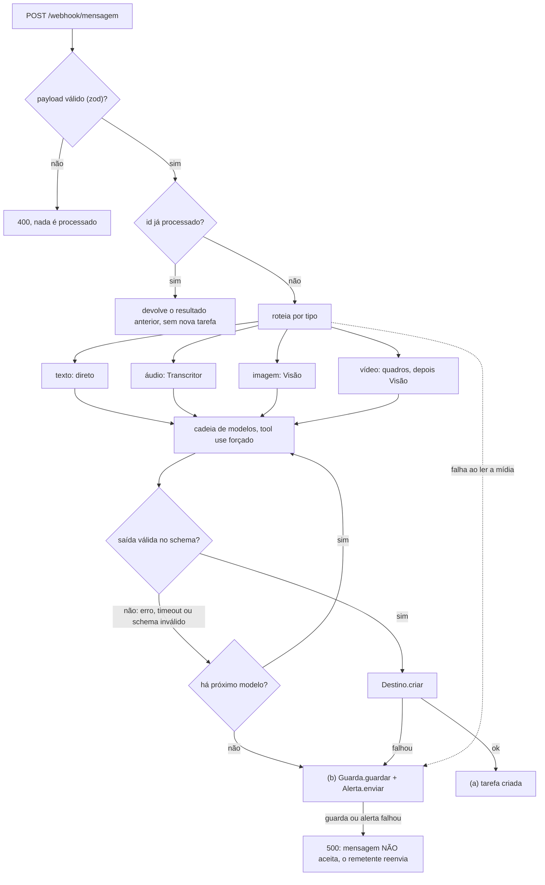

# robo-suporte-whatsapp

> **In English, in 5 lines.**
> A factory floor reports problems by chat (text, voice, photo, video). This service turns each report into a task using an LLM with forced tool use and a validated schema.
> If the primary model fails (error, timeout, invalid output), the next model in the chain is tried.
> Core invariant: **no message is lost**. Every accepted message ends in exactly one state: (a) task created, or (b) original message stored plus an alert sent. Never both, never neither.
> Duplicate deliveries (same message id) produce one task. Sinks are pluggable (local JSON by default, ClickUp), as are alerts (console, SMTP) and the model chain.
> `npm run demo` runs everything offline with a deterministic fake model and fictional data. TypeScript (strict), Node 22, Fastify, zod, Vitest.

## O problema

Numa fábrica, o aviso de um problema ("a esteira parou", "tem goteira no recebimento") chega num grupo de WhatsApp, no meio de dezenas de outras mensagens. Alguém lê, esquece, ou nem vê, e o aviso se perde.
Este serviço pega cada aviso (texto, áudio, foto ou vídeo), transforma em uma tarefa com título, local, prioridade e descrição, e cria a tarefa no sistema de gestão da equipe.
Se a IA não conseguir, a mensagem original é guardada e alguém é avisado por e-mail. O ponto central do projeto é esse: **nenhuma mensagem se perde**.

## Fluxo



## Decisões e trade-offs

**Por que tool use forçado.** O modelo só pode responder chamando uma ferramenta (`registrar_tarefa`) cujo schema é gerado do mesmo zod que valida a resposta. Isso reduz formato quebrado, mas não elimina: por isso a saída é sempre validada de novo no nosso lado, e saída fora do schema conta como falha da tentativa. O id da mensagem não é pedido ao modelo; o sistema coloca (modelo nenhum precisa acertar um id para a rastreabilidade funcionar). Trade-off: o schema é rígido de propósito, então um aviso ambíguo pode virar título genérico e local "Não informado" em vez de erro.

**Por que uma cadeia de modelos.** Provedor cai, estoura limite, devolve lixo. Com uma lista ordenada (`CADEIA_MODELOS`, por exemplo um da Anthropic e depois um da OpenAI) a queda de um não derruba o serviço. Cada tentativa tem timeout próprio; erro, timeout e saída inválida são tratados igual: próximo da lista. Trade-off: na pior hora a latência soma os timeouts de todos os modelos, e o modelo reserva pode classificar de forma um pouco diferente do principal.

**A invariante: nenhuma mensagem se perde.** Toda mensagem aceita termina em exatamente um destes estados:
(a) tarefa criada, ou
(b) mensagem original guardada **e** alerta enviado.
Cobre também falha ao ler a mídia e falha do destino depois da IA ter dado certo. Se nem o plano B fecha (guarda ou alerta indisponível), o webhook responde 500 e a mensagem **não conta como aceita**: o remetente reenvia e o mesmo id roda de novo. O teste `test/pipeline.test.ts` percorre uma tabela de cenários (1º modelo ok, 1º falha e 2º ok, os dois falham, timeout, schema inválido, destino falhando depois da IA) e confere nos três adaptadores que sobrou exatamente um destino final.
Limites honestos: se o alerta cair depois de a mensagem ser guardada e a reentrega depois der certo, a cópia guardada é descartada; se *esse* descarte também falhar, ficam as duas coisas (registrado no log). E, se o destino aceitar a tarefa mas o registro de ids falhar logo em seguida, uma reentrega pode duplicar, a menos que o destino seja idempotente (o adaptador JSON é; o do ClickUp não tem chave de idempotência na API).

**Idempotência.** O WhatsApp reenvia webhook quando a resposta demora. O id da mensagem é a chave: um registro de ids processados devolve o resultado anterior sem chamar IA nem destino, e duas entregas simultâneas do mesmo id compartilham a mesma execução. Uma duplicata de mensagem que terminou em (b) não gera segundo alerta. Trade-off: reprocessar uma mensagem guardada exige apagar o registro dela ou mandar com id novo (decisão consciente, para o reenvio automático não virar alerta repetido).

**Custo por mensagem.** Fórmula: `tokens de entrada × preço de entrada + tokens de saída × preço de saída`, do modelo que respondeu (normalmente só o primeiro da cadeia); áudio soma a transcrição, imagem e vídeo somam a leitura de cada imagem. Ordem de grandeza do tamanho (estimativa minha, não medida): algumas centenas de tokens de entrada (instrução, schema da ferramenta e aviso) e poucas dezenas a ~150 de saída. Preço em dinheiro: **a conferir** nas páginas de preço de cada provedor; não coloco número aqui para não publicar valor desatualizado.

## Como rodar

Requisitos: Node 22 ou mais novo.

```bash
npm install
npm run demo        # sem chave nenhuma: modelo falso + adaptadores locais
```

A demo injeta as mensagens de `exemplos/mensagens/`, mostra as tarefas criadas, um caso em que o modelo principal falha e o reserva responde, um caso em que os dois falham e a mensagem termina em (b) com alerta, e um reenvio que não gera segunda tarefa. No fim ela confere a invariante nos arquivos que ficaram em disco (`dados/demo/`, ignorado pelo git). Os marcadores `[falha-primario]` e `[falha-simulada]` no texto de dois exemplos existem só para derrubar o modelo falso de propósito.

Servidor HTTP:

```bash
cp .env.example .env     # preencha só o que for usar
npm start                # POST http://localhost:3000/webhook/mensagem
```

Formato do webhook (validado por zod, `src/tipos.ts`):

```json
{ "id": "abc-123", "autor": "operador-01", "tipo": "texto", "conteudo": "Esteira 2 parou" }
{ "id": "abc-124", "autor": "operador-01", "tipo": "audio", "url": "https://...", "legenda": "opcional" }
```

`tipo` é `texto`, `audio`, `imagem` ou `video`. Texto exige `conteudo`; as demais exigem `url` e aceitam `legenda`. Respostas: `200` (terminou em (a) ou (b); o corpo diz qual), `400` (payload inválido), `401` (se `WEBHOOK_TOKEN` estiver definido e o cabeçalho `x-webhook-token` não bater), `500` (plano B falhou, reenvie).

Variáveis em `.env.example`. Cadeia de modelos: `CADEIA_MODELOS=provedor:modelo,provedor:modelo` (provedores `anthropic`, `openai`, `fake`; o nome do modelo é o que o provedor documenta, o repositório não fixa nenhum). Destino: `DESTINO=json` (padrão) ou `clickup`. Alerta: `ALERTA=console` (padrão) ou `smtp`.

### Como plugar o WhatsApp

Fora de escopo aqui. A API do WhatsApp (Evolution, Meta Cloud API ou outra) entra como um conversor pequeno: recebe o evento do provedor, monta o JSON acima e faz `POST /webhook/mensagem`. O id do provedor para a mensagem é o `id`, e é ele que dá a idempotência.

## Como testar

```bash
npm run lint
npx tsc --noEmit
npm test
```

Nenhum teste usa rede nem chave: os provedores externos são testados com `fetch` substituído. Arquivos: `pipeline.test.ts` (invariante e idempotência), `cadeia.test.ts`, `processamento.test.ts` (roteamento por tipo), `webhook.test.ts` (200, 400, 401, 500), `local.test.ts`, `externos.test.ts`, `composicao.test.ts`. A CI (`.github/workflows/ci.yml`) roda os mesmos três comandos em push e pull request.

## O que não foi verificado

- Os adaptadores Anthropic, OpenAI, Groq, ClickUp, SMTP e ffmpeg nunca falaram com o serviço real neste repositório, só com respostas simuladas no formato documentado. Antes de produção, rode uma mensagem de verdade em cada um.
- Alguns modelos podem recusar `tool_choice` forçado. Se acontecer, o provedor devolve erro, a cadeia trata como falha e segue para o próximo modelo; confira na documentação do modelo escolhido.
- O processamento é síncrono dentro da requisição. Com provedor que exige resposta rápida, o certo é responder 202 e processar numa fila (não incluída).
- O download de mídia por URL não filtra destino (risco de SSRF se o webhook for público). Proteja com `WEBHOOK_TOKEN` e rede.
- A transcrição e a visão não têm adaptador "fake por arquivo" fora da demo: sem `GROQ_API_KEY` ou `VISAO_MODELO_ANTHROPIC`, áudio, imagem e vídeo vão para (b).

## Estrutura

```
src/
  tipos.ts          schemas zod e interfaces plugáveis
  processamento.ts  roteamento por tipo
  cadeia.ts         cadeia de modelos com timeout e validação
  pipeline.ts       invariante e idempotência
  webhook.ts        Fastify, POST /webhook/mensagem
  composicao.ts     monta tudo a partir de variáveis de ambiente
  servidor.ts       npm start
  demo.ts           npm run demo
  adaptadores/      local, memoria, fake, anthropic, openai, groq, clickup, smtp, ffmpeg
exemplos/           mensagens fictícias da demo
test/               testes Vitest
```

## Licença

MIT.

---

Versão aberta, com dados fictícios, de um sistema que roda todo dia numa fábrica de alimentos desde 2026.
